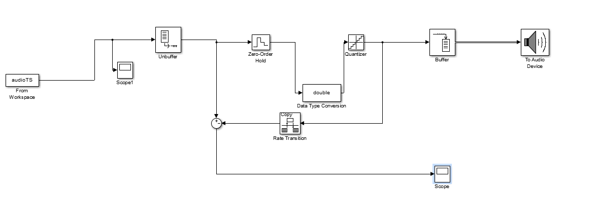

# Signal Processing Laboratories

MATLAB, Simulink and SHARC DSP exercises covering spectral analysis, correlation, radar detection, sampling, quantisation and digital filtering.



*Original Simulink audio-sampling and quantisation model from the laboratory study.*

## Repository guide

| Location | Contents |
|---|---|
| [Traitement_Signal_MATLAB/](Traitement_Signal_MATLAB/) | MATLAB scripts and signal-processing reports |
| [TP1_Quantification_du_son/](TP1_Quantification_du_son/) | Simulink sampling and audio quantisation study |
| [DSP_SHARC_Filtre_IIR/](DSP_SHARC_Filtre_IIR/) | Second-order IIR filter, interrupt routine and host tests |
| [archive/](archive/) | Original laboratory captures, scripts and development variants |

## Additional laboratory reports

The MATLAB module now includes the [RC low-pass report](Traitement_Signal_MATLAB/docs/rc_low_pass_report.pdf) and [amplitude-modulation report](Traitement_Signal_MATLAB/docs/amplitude_modulation_report.pdf). Their original MATLAB/Simulink figures document frequency-response and carrier/envelope experiments. See the [module guide](Traitement_Signal_MATLAB/README.md) for the relationship between the report parameters and the current scripts.

## Getting started

For MATLAB, open the relevant script from `Traitement_Signal_MATLAB/src/` and run it with that folder as the working directory. For Simulink, open `TP1_Quantification_du_son/tp1_cdm.slx`. DSP host checks use:

```bash
make -C DSP_SHARC_Filtre_IIR test
```

## Project context

Canonical modules are separated from original imports. The SHARC hardware routine targets ADSP-21060 with an AD1847 codec; host tests do not replace hardware validation.
